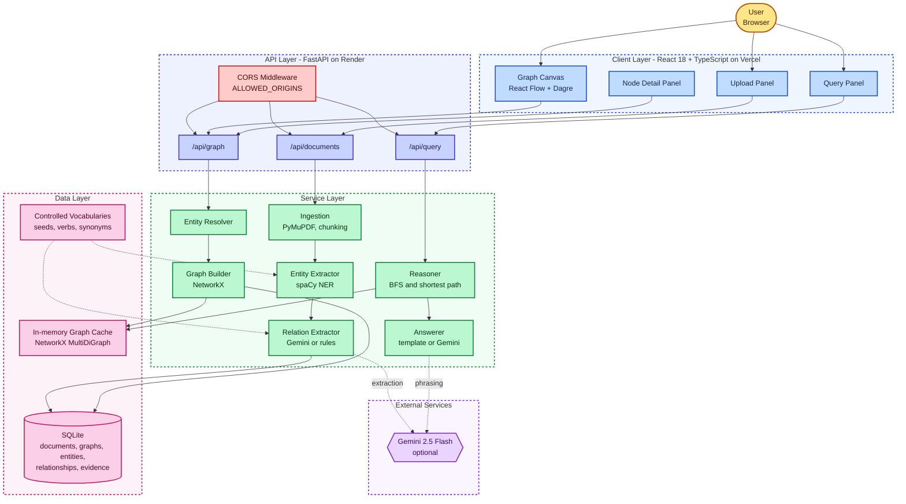
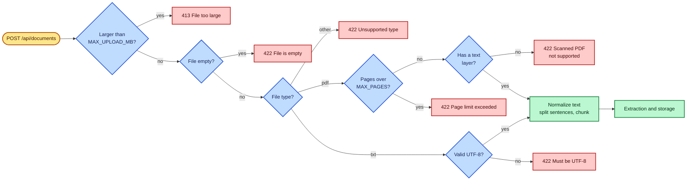
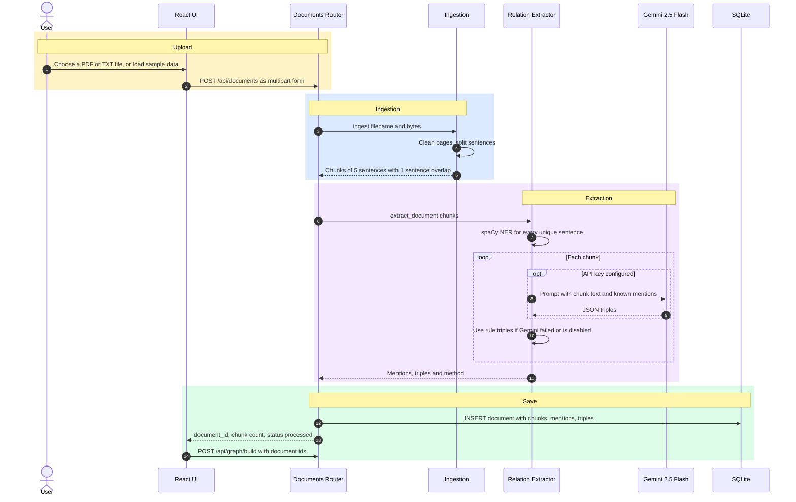
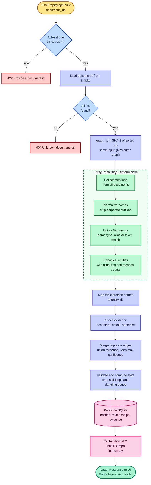
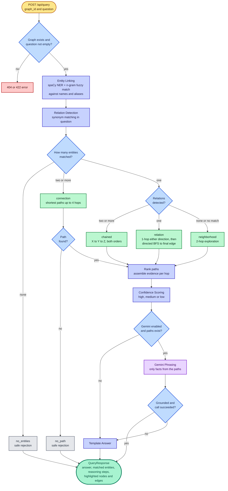
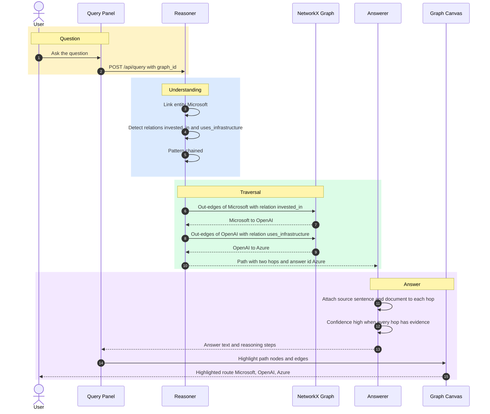
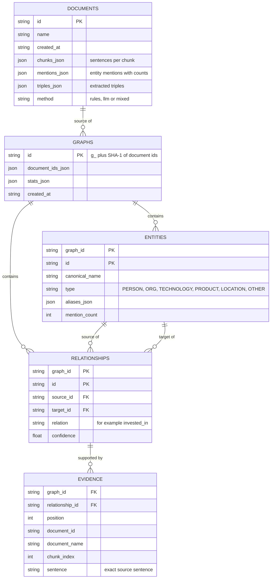
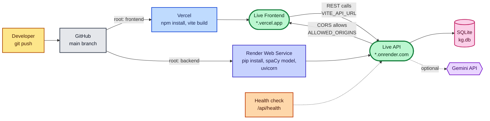

# GraphForge

[](https://graphforge-project.vercel.app/)
[](https://knowledge-graph-construction-and.onrender.com/api/health)
[](https://www.python.org/)
[](https://fastapi.tiangolo.com/)
[](https://react.dev/)
[](https://www.typescriptlang.org/)
[](https://www.docker.com/)

An end-to-end neuro-symbolic engine that transforms unstructured text and PDFs into structured knowledge graphs, visualizes complex networks interactively, and answers natural language questions through multi-hop traversal with complete evidence provenance. GraphForge uses spaCy and Gemini for extraction, NetworkX for reasoning, and React Flow for exploration.

**Live Demo:** [https://graphforge-project.vercel.app/](https://graphforge-project.vercel.app/)

---

## Table of Contents

1. [Overview](#overview)
2. [Tech Stack](#tech-stack)
3. [Architecture](#architecture)
   - [1. System Overview](#1-system-overview)
   - [2. Upload Validation Flow](#2-upload-validation-flow)
   - [3. Document Processing Sequence](#3-document-processing-sequence)
   - [4. Relation Extraction with Fallback](#4-relation-extraction-with-fallback)
   - [5. Graph Build and Entity Resolution](#5-graph-build-and-entity-resolution)
   - [6. Query and Reasoning Flow](#6-query-and-reasoning-flow)
   - [7. Multi-Hop Query Sequence](#7-multi-hop-query-sequence)
   - [8. Database Schema](#8-database-schema)
   - [9. Deployment Pipeline](#9-deployment-pipeline)
4. [Getting Started](#getting-started)
5. [Supported Question Patterns](#supported-question-patterns)
6. [REST API Reference](#rest-api-reference)
7. [Configuration Reference](#configuration-reference)
8. [Testing](#testing)
9. [Deployment](#deployment)
10. [Implementation Highlights](#implementation-highlights)
11. [Project Structure](#project-structure)
12. [License](#license)

---

## Overview

GraphForge bridges the gap between unstructured documents and queryable knowledge. Upload a PDF or text file, and the engine extracts entities and relationships, resolves duplicate names into canonical entities, builds a graph, and lets you ask questions that require chaining several facts together. Every answer shows the exact path it followed and quotes the source sentence behind each hop.

### Core Features

* **Robust Document Ingestion**: PDFs and raw text are parsed with PyMuPDF, with page-level cleaning, repeated header and footer removal, sentence splitting, and overlapping chunks.
* **Dual-Mode Relation Extraction**: Gemini 2.5 Flash extracts triples when an API key is configured, and a deterministic spaCy dependency-rule engine takes over per chunk if the model fails. With no API key, the rule engine runs alone and needs zero external services.
* **Intelligent Entity Resolution**: Normalizes corporate suffixes, merges aliases such as "Sam Altman" and "Altman", and applies token-based fuzzy matching.
* **Interactive Visualization**: React Flow with Dagre hierarchical layout, real-time node filtering, search, type badges, and degree statistics.
* **Explainable Multi-Hop Reasoning**: Directed and undirected BFS plus shortest-path search over a NetworkX multigraph. Every hop quotes its source sentence and document.
* **Safe Rejection**: If no supporting path exists, or the entities are not in the graph, the engine says so instead of guessing.
* **Graceful Degradation**: The LLM is always optional. Extraction and answer phrasing both fall back to deterministic logic.

---

## Tech Stack

| Layer | Technology |
| --- | --- |
| Frontend Framework | React 18 with TypeScript, built with Vite |
| Styling | Tailwind CSS |
| Graph Visualization | React Flow (`@xyflow/react`) with Dagre layout |
| Backend Framework | FastAPI (Python 3.11) |
| NLP | spaCy (`en_core_web_sm`) |
| Graph Engine | NetworkX (MultiDiGraph) |
| Document Parsing | PyMuPDF |
| LLM (optional) | Gemini 2.5 Flash |
| Database | SQLite with an in-memory graph cache |
| Validation | Pydantic v2 |
| Deployment | Vercel (frontend), Render (backend), Docker with Nginx |

---

## Architecture

All diagrams below are written in Mermaid and render automatically on GitHub.

### 1. System Overview



### 2. Upload Validation Flow

Every upload is validated before any NLP work starts. Each failure returns a clear HTTP error with a readable message.



### 3. Document Processing Sequence



### 4. Relation Extraction with Fallback

Extraction never depends on the LLM. Each chunk is handled independently, so one failed model call does not break the document.

```mermaid
flowchart LR
    A(["Chunks of a document"]):::start --> B["spaCy NER<br/>mentions per sentence"]:::nlp
    B --> C{"GEMINI_API_KEY<br/>configured?"}:::check
    C -->|"no"| R["Rule Engine<br/>dependency paths, verb map,<br/>relation synonyms"]:::rules
    C -->|"yes"| D["Gemini 2.5 Flash<br/>JSON mode, temperature 0"]:::ai
    D --> E{"Call succeeded<br/>and JSON valid?"}:::check
    E -->|"no"| W["Log warning<br/>retry on HTTP 429 with backoff"]:::warn
    W --> R
    E -->|"yes"| F["Grounding Check<br/>entities must match mentions,<br/>sentence must exist in chunk"]:::ai
    F --> T["LLM triples"]:::ai
    R --> U["Rule triples"]:::rules
    T --> M{"Methods used<br/>across chunks"}:::check
    U --> M
    M -->|"one method"| X["method: llm or rules"]:::ok
    M -->|"both"| Y["method: mixed"]:::ok
    X --> Z[("Saved to documents table")]:::data
    Y --> Z

    classDef start fill:#fde68a,stroke:#b45309,stroke-width:2px,color:#451a03
    classDef nlp fill:#bfdbfe,stroke:#1d4ed8,stroke-width:2px,color:#172554
    classDef check fill:#c7d2fe,stroke:#4338ca,stroke-width:2px,color:#1e1b4b
    classDef rules fill:#bbf7d0,stroke:#15803d,stroke-width:2px,color:#052e16
    classDef ai fill:#e9d5ff,stroke:#7e22ce,stroke-width:2px,color:#3b0764
    classDef warn fill:#fed7aa,stroke:#c2410c,stroke-width:2px,color:#431407
    classDef ok fill:#a7f3d0,stroke:#047857,stroke-width:2px,color:#064e3b
    classDef data fill:#fbcfe8,stroke:#be185d,stroke-width:2px,color:#500724
```



### 5. Graph Build and Entity Resolution



### 6. Query and Reasoning Flow



### 7. Multi-Hop Query Sequence

The canonical example: *"Which cloud infrastructure is associated with the company Microsoft invested in?"*



### 8. Database Schema

SQLite stores every document and every built graph. Graph tables are keyed by `graph_id`, so many graphs can coexist. A graph references its source documents through a JSON list of ids.



### 9. Deployment Pipeline



---

## Getting Started

### Option 1: Docker Compose (Recommended)

Run the entire stack (frontend, backend, SQLite, reverse proxy) with a single command.

```bash
# 1. Clone the repository
git clone https://github.com/sourabhvamdevan/GraphForge.git
cd GraphForge

# 2. (Optional) Add a Gemini API key
cp .env.example .env      # Windows: copy .env.example .env

# 3. Build and start the containers
docker-compose up --build
```

* **Frontend**: [http://localhost:5173](http://localhost:5173)
* **API Swagger Docs**: [http://localhost:8000/docs](http://localhost:8000/docs)

### Option 2: Local Development

#### Prerequisites

* **Python 3.10+** (tested on 3.11.9)
* **Node.js 18+** and **npm**

#### 1. Backend

```bash
cd backend
python -m venv venv
source venv/bin/activate      # Windows: .\venv\Scripts\activate
pip install -r requirements.txt
python -m spacy download en_core_web_sm
cp .env.example .env          # Windows: copy .env.example .env
uvicorn app.main:app --reload
```

The backend runs on `http://localhost:8000`.

#### 2. Frontend (new terminal)

```bash
cd frontend
npm install
cp .env.example .env          # Windows: copy .env.example .env
npm run dev
```

The frontend runs on `http://localhost:5173`.

---

## Supported Question Patterns

| Pattern | Example Question | Resolution Method |
|---|---|---|
| **Direct Lookup** | *"Who founded OpenAI?"* | One-hop relation match in either direction, then directed BFS to an edge of that relation |
| **Chained Multi-Hop** | *"Which cloud infrastructure is associated with the company Microsoft invested in?"* | `Entity A -> r1 -> Entity B -> r2 -> Entity C`, trying both relation orders |
| **Entity Connection** | *"How are Sam Altman and Microsoft connected?"* | Shortest paths over the undirected graph, up to 4 hops |
| **Exploratory Fallback** | *"Tell me about Nvidia"* | Two-hop neighborhood exploration, always low confidence |
| **Unknown Entity** | *"What did QuantumCorp acquire?"* | Safe rejection when no entity is found in the graph |

The canonical example resolves through `Microsoft -invested_in-> OpenAI -uses_infrastructure-> Azure`, with sentence-level attribution for each hop and path highlighting on the canvas.

---

## REST API Reference

Interactive OpenAPI documentation is available at `/docs`.

| Method | Endpoint | Description |
|---|---|---|
| `POST` | `/api/documents` | Upload and process a PDF or TXT document (multipart) |
| `POST` | `/api/documents/sample` | Load and process the bundled AI ecosystem dataset |
| `GET` | `/api/documents` | List all processed documents |
| `POST` | `/api/graph/build` | Build a knowledge graph from selected document ids |
| `GET` | `/api/graph/{graph_id}` | Retrieve the full graph (entities, relationships, statistics) |
| `GET` | `/api/graph/{graph_id}/entity/{id}` | Inspect incoming and outgoing relationships of one entity |
| `GET` | `/api/graph/{graph_id}/search?q=` | Fuzzy entity search across canonical names and aliases |
| `GET` | `/api/graph/{graph_id}/export` | Export graph data as JSON |
| `POST` | `/api/query` | Run natural language multi-hop reasoning |
| `GET` | `/api/health` | Service status and LLM configuration check |

---

## Configuration Reference

### Backend (`backend/.env`)

| Variable | Default | Description |
|---|---|---|
| `GEMINI_API_KEY` | *(empty)* | Optional. If omitted, the engine runs in deterministic rule-based mode |
| `GEMINI_MODEL` | `gemini-2.5-flash` | Gemini model for relation extraction and answer phrasing |
| `DATABASE_URL` | `sqlite:///./kg.db` | SQLite database path |
| `ALLOWED_ORIGINS` | `http://localhost:5173` | Comma-separated list of allowed CORS origins |
| `MAX_UPLOAD_MB` | `10` | Maximum upload size |
| `MAX_PAGES` | `50` | Maximum PDF page count |

### Frontend (`frontend/.env`)

| Variable | Default | Description |
|---|---|---|
| `VITE_API_URL` | `http://localhost:8000/api` | Base URL of the backend API |

---

## Testing

The test suite runs completely offline with the LLM layer mocked.

```bash
cd backend
pytest
```

To run the sample extraction benchmark:

```bash
python -m scripts.extract_sample
```

---

## Deployment

The project deploys as two independent services.

### Backend on Render (Web Service)

| Setting | Value |
|---|---|
| Root Directory | `backend` |
| Runtime | Python 3 |
| Build Command | `pip install -r requirements.txt && python -m spacy download en_core_web_sm` |
| Start Command | `uvicorn app.main:app --host 0.0.0.0 --port $PORT` |
| Health Check Path | `/api/health` |

Add the variables from the [Configuration Reference](#configuration-reference) plus `PYTHON_VERSION=3.11.9`. Alternatively, use the included `render.yaml` as a Render Blueprint.

### Frontend on Vercel

1. Import the repository and set **Root Directory** to `frontend`.
2. Add `VITE_API_URL` with the value `https://<your-render-service>.onrender.com/api`.
3. Deploy, then set `ALLOWED_ORIGINS` on Render to the final Vercel URL (no trailing slash) and redeploy the backend.

Notes:

* Render's free tier sleeps after inactivity, so the first request can take 30 to 60 seconds.
* The SQLite file is not persistent on the free tier and may reset on redeploy.
* `VITE_API_URL` is baked in at build time, so redeploy the frontend after changing it.

---

## Implementation Highlights

* **Two-Stage Pipeline**: Extraction runs once per document at upload and is stored, so graphs can be rebuilt from any combination of documents without re-running NLP.
* **Deterministic Graph IDs**: The graph id is a hash of the sorted document ids, so the same inputs always rebuild the same graph.
* **Per-Chunk Fallback**: A failed Gemini call affects only one chunk, which is re-extracted with rules. The document records `rules`, `llm` or `mixed`.
* **Grounded LLM Output**: Extracted entities must match known mentions, and phrased answers are checked against the reasoning paths before they are shown.
* **Evidence Provenance**: Every relationship stores the exact source sentence, chunk and document it came from.
* **Rate Limit Handling**: Gemini calls use exponential backoff with jitter on HTTP 429.
* **In-Memory Graph Cache**: NetworkX graphs are cached after build, with SQLite as the source of truth.
* **Containerization**: Docker Compose with a Python backend image and a multi-stage frontend build served by Nginx.

---

## Project Structure

```text
backend/
  app/
    routers/       FastAPI route handlers (documents, graph, query)
    services/      Ingestion, NER, relation extraction, resolver, graph builder, reasoner, answerer, LLM client
    config.py      Pydantic settings
    db.py          SQLite schema, persistence and graph cache
    main.py        FastAPI entrypoint, CORS and startup
    models.py      Data models and response schemas
  data/            Controlled vocabularies, seed entities and sample dataset
  tests/           Pytest suite
  scripts/         Sample extraction benchmark
frontend/
  src/
    api/           Typed API client
    components/    GraphCanvas, QueryPanel, UploadPanel, NodeDetailPanel, SearchFilterBar
    lib/           Dagre layout, styling helpers, example questions
    types.ts       TypeScript types mirroring backend models
    App.tsx        Main application shell
  nginx.conf       Production Nginx configuration
docker-compose.yml Multi-container orchestration
render.yaml        Render backend blueprint
plan.md            System design and implementation specification
```

---

